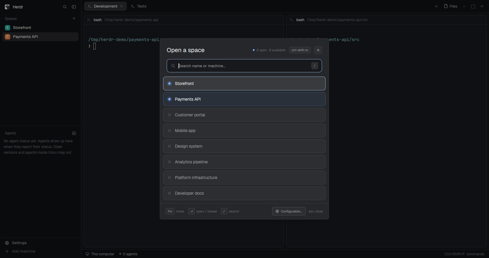

# Space Builder

Configure your terminal workspaces and open them in Herdr with their tabs, split
panes, working directories, and commands already set up.



## Get started

By default, Space Builder reads **`spaces.json` from `${HERDR_APP_HOME:-$HOME/.config/herdr-app}/`**:

```text
${HERDR_APP_HOME:-$HOME/.config/herdr-app}/spaces.json
```

Create this file using the example below, then open Space Builder with
**Ctrl+Shift+M**. To keep your configuration elsewhere, click **Configuration…**
and choose the folder containing `spaces.json`. Space Builder remembers that
location. Reopen the popup after editing the file to load your changes.

## Write your configuration

The `spaces` list contains your saved workspaces. Replace the example directory
with an existing project folder and choose the commands you want to start.

```json
{
  "spaces": [
    {
      "name": "development",
      "machine": null,
      "tabs": [
        {
          "name": "Code",
          "panes": [
            {
              "id": "editor",
              "working_dir": "~/projects/my-app",
              "command": "nvim"
            },
            {
              "id": "tests",
              "working_dir": "tests",
              "command": null,
              "split_from": "editor",
              "split": "right"
            },
            {
              "id": "shell",
              "split_from": "tests",
              "split": "down"
            }
          ]
        }
      ]
    }
  ]
}
```

This opens a Code tab with an editor in your project, a terminal in its `tests`
folder, and another terminal in the project folder. The last terminal inherits
the root pane's directory, even though it splits from the tests terminal.

Add more objects to `spaces` for more workspaces, or to `tabs` for more tabs.
A direct array of spaces or a single space object is also accepted. Use valid
JSON without comments or trailing commas.

### Space keys

| Key | Required | What it does |
| --- | --- | --- |
| `name` | Yes | The space name. Must be nonempty and unique on its machine within this file. Names are case-sensitive. |
| `machine` | No | An existing Herdr machine name, such as `"build-vm"`. Omit it, use `null`, or leave it blank for this computer. |
| `tabs` | Yes | A list containing at least one tab. |

You can use the same space name on different machines. For a remote space,
its directories and commands refer to that machine, which must be connected.

### Tab keys

| Key | Required | What it does |
| --- | --- | --- |
| `name` | No | The tab label. Omit it to use Herdr's default numbered label. |
| `panes` | Yes | A list containing at least one pane. |

### Pane keys

| Key | Required | What it does |
| --- | --- | --- |
| `id` | Yes | A nonempty identifier, unique within this tab, used by other panes when splitting. |
| `working_dir` | No | The pane's starting directory. See the directory rules below. |
| `command` | No | A command to run in the pane's shell. Omit it, use `null`, or use an empty string for a plain shell. |
| `split_from` | For split panes | The `id` of an earlier pane to split. |
| `split` | With `split_from` | `"right"` or `"down"`: where the new pane appears beside the referenced pane. |

Each tab needs exactly one **root pane**, without `split_from`. Put it first,
then list split panes after the panes they reference. Commands must be available
on the machine where the space opens.

## Working directories

- A root pane uses its `working_dir`. If omitted, `null`, or empty, Herdr chooses
  its normal starting directory.
- Other panes without a `working_dir` inherit their tab's root directory,
  regardless of which pane they split from.
- A relative directory on a child pane, such as `"tests"`, is relative to the
  root pane's directory. A relative directory on a root uses the focused
  terminal's directory on the target machine, or that machine's home when
  opening from another machine.
- Use an absolute path or `~/folder` for a predictable starting directory.
  Windows drive and UNC paths are also supported; escape backslashes in JSON
  or use forward slashes.
- Directories must already exist. Space Builder does not create them.

Directories belong to panes. Space-level `folder` and `id` keys are no longer
supported. For an older configuration, move the space's `folder` value to each
tab's root `working_dir`, then remove the space-level `folder` and `id` keys.
Keep pane IDs for split references.

## Open and reload spaces

Search by space name or machine. Use **↑/↓** to select a result and **Enter** to
open it, or click its row. **/** focuses search; **Esc** closes the popup.
Already-open spaces appear first with a filled status dot.

A space is considered open when its **name and machine** match an existing
space. Selecting it asks before reloading: **reload closes that space and its
running terminals**, then opens it again using your saved configuration.
Choose Cancel or press Esc to return to the list without reloading.

If multiple spaces have the same name on the same machine, rename or close one
before reloading. Renaming a space or its configuration changes which space it
matches.

While opening a space, the popup shows “Loading the space…”. When finished,
the popup closes and the first tab's root pane is focused. Closing the popup
during loading cancels unfinished work and attempts to remove the partial
space. If cleanup fails, use **Close partial space**.

If a configuration is disabled, click it to see what needs attention, such as
an invalid setting or an unavailable machine. For a missing or unreadable config
file, the popup shows the problem and the expected path; fix the file or use
**Configuration…** to choose another folder.

## Development

Use Node.js 22. Run `npm test`; no dependencies need installation.
GitHub Actions runs these tests on pushes and pull requests.
For UI changes, also run `herdr-app check mods/space-builder` and test in Herdr.
