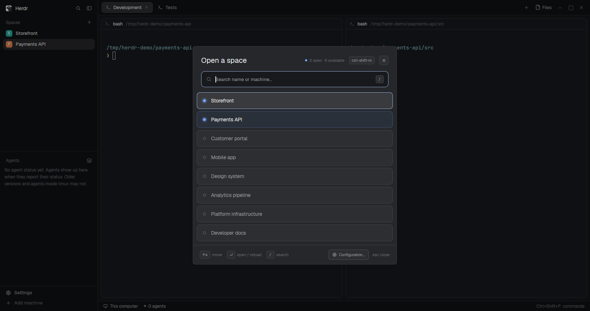

# Space Builder

Configure your terminal workspaces and open them in Herdr with their tabs, split
panes, working directories, and commands already set up.

A dialog lists saved spaces. Select one to open its tabs and terminal panes
in set directories and run commands. Confirm before you reload an open space.

## What you see

- Centered dialog: 560 px wide, theme colors, popover background.
  Heading: "Open a space", 20 px semibold, counts, shortcut, close button.
  Search field: 44 px high.
- Rows: 46 px high, 6 px gaps, 13.5 px names, remote machine labels.
  Show eight rows at most; scroll for more. Open spaces have filled dots
  in the done color; other dots are hollow. Use selected and accent colors
  for selection, hover color on hover, reduced opacity for disabled rows.
- Footer: key hints and "Configuration…". Show file errors and the expected path.

## How it behaves

- Ctrl+Shift+M opens or closes. Read the configuration on open.
  Focus search when entries exist. Match all words against name and machine;
  ignore letter case. Put open spaces first. Keep selection when order changes.
- Up/Down select enabled rows and repeat from the opposite end. Enter or
  a row click opens. Wheel scrolls. Slash focuses search. Esc closes.
  Disabled row clicks show errors. "Clear search" removes the query.
- "Configuration…" selects the folder that contains the configuration file.
  Save the path and read the file.
- Match open spaces by exact name and machine. Ask before reload closes their
  terminals. Left/Right select Reload or Cancel; Enter accepts. Esc cancels.
  Reject multiple matching spaces.
- Show "Loading the space…" during creation. Close on success; focus the first
  tab's root pane. On failure or close, stop work and try to remove the partial
  space. Offer "Close partial space" if cleanup fails.
  Agent states (working, blocked, done, idle) do not change the display.

## Built from

- Create `mods/space-builder/main.js`, `config.js`, and `mod.json`.
  Use a gpui-kit `View` and gpui-base input. Follow the installed type files.
  Manifest: `{"place":"none","title":"Space builder","overlay":{"kind":"dialog","width":560}}`.
  Close with `closeOverlay(props().overlay)`.
  Without an overlay, do not read files or start tasks.
- Read `appHome() + "/spaces.json"` with `readTextFile()`.
  Save a `pickFolder()` choice with `shared()`/`setShared()`.
  Accept `{ "spaces": [...] }`, an array, or one space object.
  Space: required `name`, nonempty `tabs`; optional `machine` (null/blank means local).
  Tab: optional `name`, required nonempty `panes`.
  Pane: required `id`; optional `working_dir`, `command`;
  splits require `split_from` and `split` (`right` or `down`).
  Space names and pane IDs are nonempty strings. Optional text is string or null.
- Run `herdr-app do` through `exec()` to get IDs:
  `space.new`, `tab.new`, `pane.split`, `tab.select`, `pane.focus`, `space.close`.
  Target IDs explicitly. Wait for shells; `hc send` submits commands with Enter.
  Check directories through `sh`, or `pwsh`/`powershell`; use `on` for remote checks.
  Use shipped search, server, file-text, x, settings SVGs in `mods/workspace-chrome/`.
- Install under `~/.config/herdr-app/mods/space-builder/`, or
  `$HERDR_APP_HOME/mods/space-builder/` when set. Merge into `keys.json`:
  `global`: `"ctrl-shift-m":"mod.open:space-builder"`;
  `mod:space-builder`: `"escape":"space-builder.escape"` (use `nextCommand()`).
  Ask before replacing assigned keys. Tell the user about configuration reads
  and execution of shells, `herdr-app`, and `hc`.

## Watch out

- Space names must be unique per machine; pane IDs, per tab.
  Each tab needs one root without `split_from`. Splits name earlier panes.
  Reject space-level `folder` and `id`.
- Missing/null/empty directories mean Herdr defaults for roots, tab root for
  children. Relative children use the root, never the split parent.
  Relative roots use the focused directory on that machine, otherwise its home.
  Support absolute, `~/`, Windows drive, and UNC paths. Quote shell paths.
- Require existing directories and a ready machine. Check paths before reload.
  Resolve children of unspecified roots after shell startup.
  Empty commands leave shells. Split sizes use Herdr defaults.
- Block concurrent builds of the same name/machine. Record created IDs before
  checking cancellation. Cleanup closes only the space this build made.

## Done when

- `herdr-app check mods/space-builder` passes. In the app, test keys, search,
  scrolling, errors, and configuration selection. Reopen to check the saved path.
- Create two tabs with both split directions and a split from a child.
  Check directories, root inheritance, and command output. Repeat on a remote machine.
- Cancel preserves an open space. Confirm replaces only its name/machine match.
  Invalid paths and multiple matches prevent reload.
- Close during creation: commands stop and partial terminals close.
  Test cleanup failure and retry.
